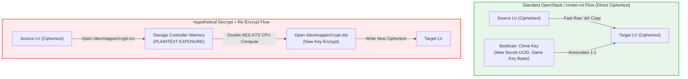
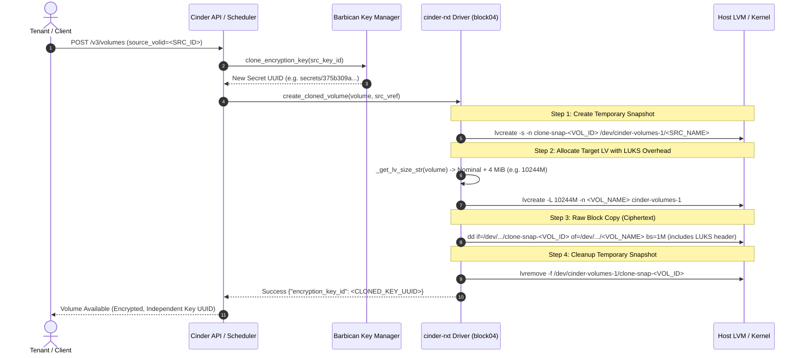
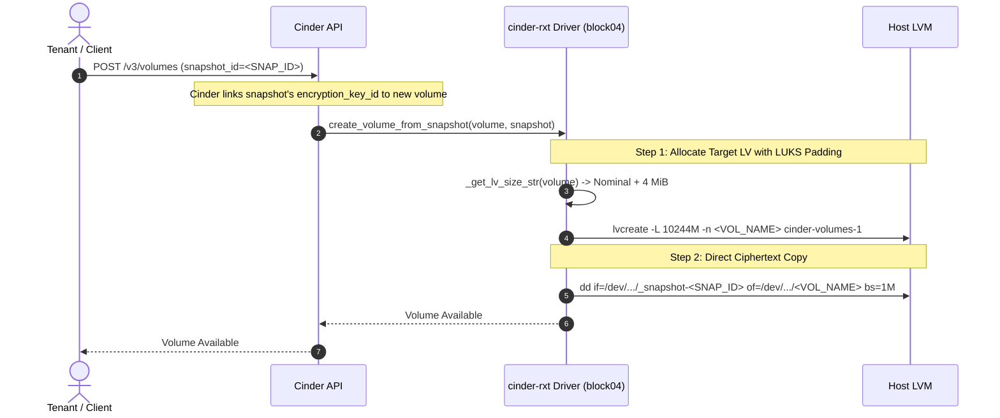

# Encrypted Volume Clone & Snapshot Architecture

## 1. Executive Summary

This document details the encryption lifecycle, Barbican key management, and block-level data flows for **cloned volumes** and **volumes created from snapshots** in `cinder-rxt`. It also addresses the architectural rationale for why Cinder and LVM perform direct ciphertext replication rather than decrypting and re-encrypting data blocks with a new cipher key.

---

## 2. Core Question: Why Doesn't Cinder Decrypt & Re-Encrypt on Clone?

When creating a cloned volume (`create_cloned_volume`) or restoring a volume from an encrypted snapshot (`create_volume_from_snapshot`), engineers often ask:

> *Can the source volume's bitwise data be decrypted on the storage node and re-encrypted with a completely new Barbican key and new cipher?*

### Technical & Architectural Reasons

While theoretically possible to mount both dm-crypt devices side-by-side on the storage node and pipe data between them, **neither upstream OpenStack Cinder nor production storage drivers do this**, for four fundamental reasons:



#### 1. Security Isolation & Plaintext Exposure on Storage Nodes
In OpenStack's security model for encrypted volumes:
- The storage controller nodes (`block01`–`block05`) **never see customer plaintext**.
- Encryption and decryption normally occur at the hypervisor (Nova compute node) when attaching the volume to the guest instance.
- If the storage driver were to decrypt and re-encrypt during a volume clone, the storage node host OS would have to open the customer's filesystem as a decrypted block device (`/dev/mapper/crypt-src`), exposing customer data in memory on a shared infrastructure node.

#### 2. Storage Node CPU Saturation & I/O Bottlenecks
- Direct ciphertext copy is a sequential raw block copy (`dd if=... of=... bs=1M`) requiring minimal CPU cycles.
- Decrypting and re-encrypting requires running **two concurrent AES-XTS crypto pipelines** per I/O block on the storage controller CPU.
- For a 100 GB or 1 TB volume, re-encrypting blocks at the storage layer would peg controller CPUs at 100%, causing severe I/O latency spikes and starvation for all other tenant volumes served by that controller.

#### 3. Preserving Fast Block Replication & COW Snapshot Semantics
- Volume cloning frequently leverages Copy-on-Write (COW) snapshots or storage array zero-copy clones.
- If data had to be decrypted and re-encrypted with a new key, every single physical block on disk would have to be read, processed, and rewritten to new storage, eliminating any potential snapshot or storage deduplication efficiency.

#### 4. LUKS Key Separation Without Re-Encrypting Blocks
- In LUKS/LUKS2, the actual bulk data is encrypted with a symmetric **Master Key**.
- User passphrases and Barbican keys unlock a **Keyslot**, which in turn provides access to the Master Key.
- If a tenant requires credential rotation, LUKS allows modifying or changing keyslots without touching the underlying encrypted data blocks.

---

## 3. Barbican Key Management: Secret UUID vs. Key Bytes

To achieve full lifecycle decoupling without decrypting the disk, OpenStack uses the **`clone_encryption_key`** pattern (provided by `cinder.volume.volume_utils` and Castellan):

```text
Source Volume:
  ID:                356eca51-ee63-48da-b904-c315274aec3a
  Encryption Key ID: secrets/a1b2c3d4-0000-0000-0000-111122223333
  Key Payload:       [0x3F, 0x8A, 0x12, ... 256-bit AES Key ...]

       │
       ▼  (Barbican clone_encryption_key API call)

Cloned Volume:
  ID:                e469cf5d-4905-419f-8397-dca969371b5a
  Encryption Key ID: secrets/375b309a-e25e-4c32-bad8-61f2e0469c14  <-- NEW UNIQUE UUID
  Key Payload:       [0x3F, 0x8A, 0x12, ... 256-bit AES Key ...]  <-- IDENTICAL KEY BYTES
```

### Why a Brand-New Secret UUID is Required:
1. **Independent Lifecycle**:
   When the source volume is deleted, Cinder's deletion workflow calls Barbican to delete `secrets/a1b2c3d4...`. Because the cloned volume holds its own secret reference (`secrets/375b309a...`), **the cloned volume remains fully functional and accessible**.
2. **Access Control & Multi-Tenant Boundaries**:
   If a volume clone is migrated or transferred to another tenant or project, the key reference is managed independently in Keystone and Barbican ACLs.

---

## 4. End-to-End Encryption Data Flows

### A. Volume Cloning Flow (`create_cloned_volume`)



1. **Key Cloning**: Barbican duplicates the secret payload under a new Secret UUID.
2. **Temporary Snapshot**: The driver creates an instantaneous LVM COW snapshot of the source LV to ensure a point-in-time consistent read while the source volume remains in use.
3. **Padded LV Allocation**: The driver allocates the target LV with the appropriate LUKS header overhead (e.g., nominal + 4 MiB) to match the source container geometry.
4. **Direct Ciphertext Transfer**: `volume_utils.copy_volume` streams the raw blocks from snapshot to target using `dd`. The copied blocks include the LUKS header and the encrypted payload.
5. **Snapshot Teardown**: The temporary snapshot LV is removed, leaving the source volume in its original state.

---

### B. Volume from Snapshot Flow (`create_volume_from_snapshot`)



1. **Target Sizing**: The new volume LV is created using `_get_lv_size_str(volume)`, incorporating the LUKS margin so that the container is not truncated.
2. **Block Copy**: The data is copied block-for-block from the snapshot device (`_snapshot-<SNAP_ID>`) to the new volume LV.
3. **Decryption on Attachment**: When an instance boots from or attaches to this new volume, Nova uses the volume's Barbican key reference to open the LUKS header seamlessly.

---

### C. Contrast: Image-to-Volume vs. Volume-to-Volume Clone

| Dimension | Image to Encrypted Volume (`copy_image_to_encrypted_volume`) | Encrypted Volume Clone (`create_cloned_volume`) |
| :--- | :--- | :--- |
| **Source Data State** | **Plaintext** (Glance raw or qcow2 image) | **Ciphertext** (Existing encrypted LVM device) |
| **Barbican Key Generation** | **Brand-new random symmetric key** | **Cloned key** (New Secret UUID, identical key bytes) |
| **LUKS Formatting** | Executed explicitly via `cryptsetup luksFormat` | Copied sector-for-sector via raw `dd` |
| **dm-crypt Involvement** | Kernel `dm-crypt` active on host during image download | **No `dm-crypt` on host**; pure block transfer |
| **Storage Node Plaintext Exposure** | Yes (temporary during initial image write) | **None** (zero plaintext exposure on storage node) |

---

## 5. Summary & Verification

- **`create_cloned_volume` and `create_volume_from_snapshot` preserve 100% data integrity** by copying the exact LUKS container and payload blocks without modifying the underlying cipher.
- **Barbican key cloning ensures independent secret lifecycle**, preventing volume bricking when parent volumes or snapshots are deleted.
- **The surgical `+4 MiB` allocation** in `cinder-rxt` guarantees that all cloned and snapshot-backed volumes retain the exact physical geometry needed to prevent payload or secondary GPT header truncation (remediating [OSPC-2358](https://rackspace.atlassian.net/browse/OSPC-2358)).
